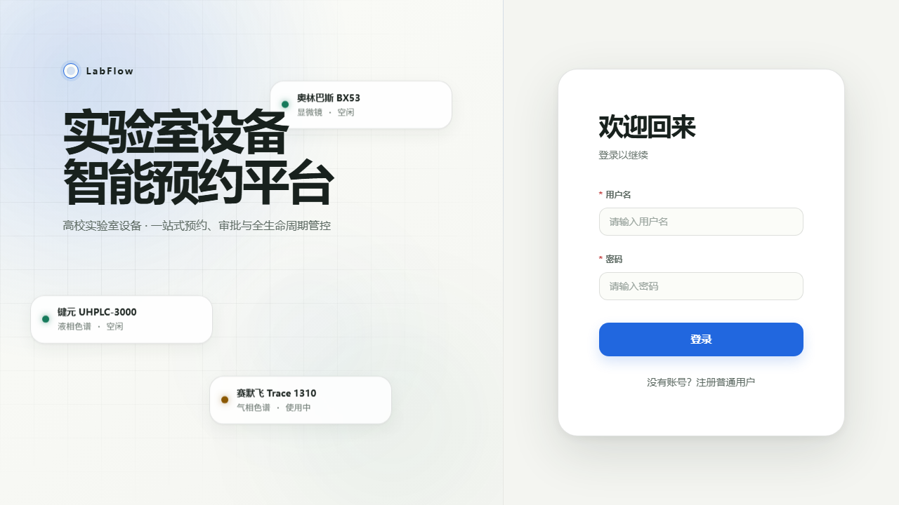

# LabFlow 实验室设备预约系统

[在线体验地址](http://www.labdevicesreservation.online)

面向高校实验室的设备共享平台，支持自然日预约、资源池、多角色审批、候补、设备交接、归还验收、报修、安全准入、报表与通知。学院是租户边界。

后端为 **Java 21 / Spring Boot / MyBatis / Flyway**，前端为 Vue 3 / TypeScript / Element Plus，依赖 MySQL 8 和 Redis 7。

## 本地启动

准备 JDK 21、Node.js、pnpm、Docker；已有 `.env` 时保留原文件，首次配置执行：

```powershell
Copy-Item .env.example .env
docker compose up -d mysql redis
cd backend-java
.\mvnw.cmd package
```

按 `.env.example` 填写数据库账号、JWT 密钥和监控配置。`LAB_MYSQL_DSN` 兼容原来的连接串，也可使用 `LAB_JDBC_URL`、`LAB_DB_USERNAME`、`LAB_DB_PASSWORD`。环境变量优先于根目录 `.env`。

**全新空库**在 `backend-java` 执行初始化：

```powershell
java -jar target/labflow-backend-1.0.0.jar --spring.main.web-application-type=none --labflow.migration=migrate
java -jar target/labflow-backend-1.0.0.jar
```

**已有业务库**必须走[保留业务数据的切换步骤](docs/springboot-cutover.md)，先核验旧迁移版本并显式 baseline；不能对已有库执行空库建表流程。默认不自动迁移、不自动 baseline。

配置 `LAB_BOOTSTRAP_ADMIN_PASSWORD`（至少 12 字符）可创建首次管理员，已有账号和密码不会覆盖。设备和组织可在管理页面维护。

另开终端启动前端：

```powershell
cd frontend
pnpm install
pnpm dev
```

页面：[http://localhost:5173](http://localhost:5173)；接口文档：[http://127.0.0.1:8000/api/v2/docs](http://127.0.0.1:8000/api/v2/docs)。接口保持 `/api/v2`。

## 验证

Java 检查见 [backend-java/README.md](backend-java/README.md)。前端执行 `pnpm build`、`pnpm test`、`pnpm test:e2e`。真实数据库测试必须指定隔离测试库，不能使用业务库。

仓库已移除 Python 源码、依赖清单与旧验收运行脚本。浏览器测试通过 Java JAR 创建和清理带 `e2e-` 前缀的隔离数据；先打包后端并配置 Java 21。数据库升级只使用 Flyway SQL，已执行的 V1–V5 保持不变。原上传目录 `backend/.data/uploads` 保留。

## 前端流程截图册

[查看流程截图（14 条流程，24 张关键截图）](.artifacts/browser-flow-20261014/viewer/gallery.md)

覆盖预约审批、交接与归还验收、报修、通知及权限隔离，每条流程保留关键截图。


